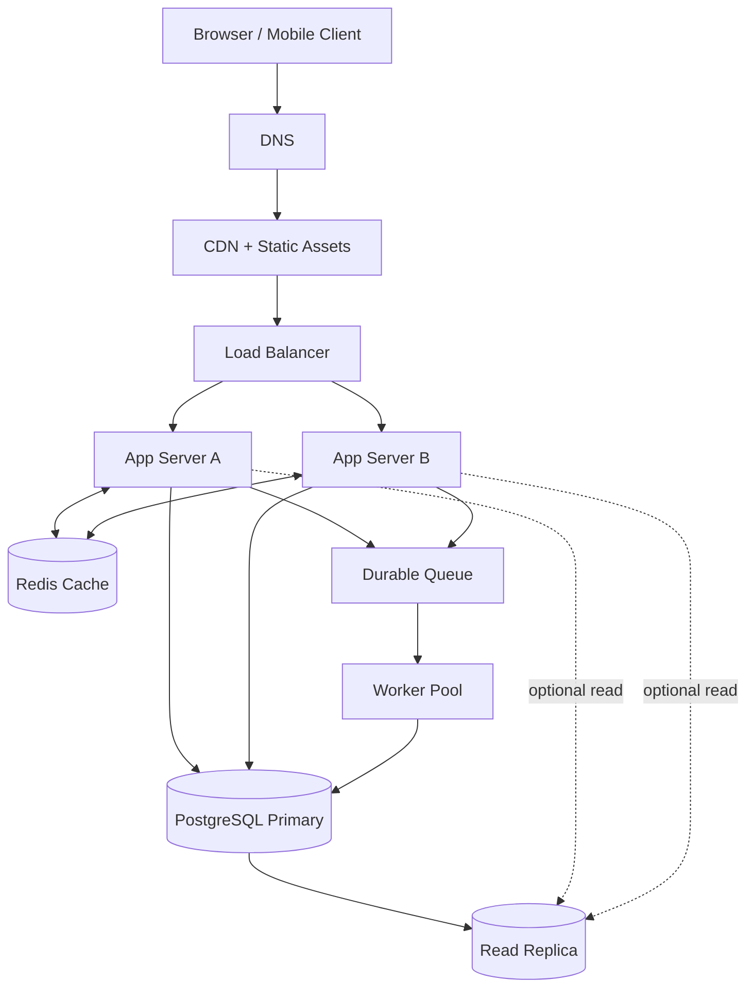

# QuickNotes Architecture — 1 Million Users

## Functional requirements
- Register, sign in and authenticate users securely.
- Create, read, update and delete notes owned by the authenticated user.
- Create tags, attach/detach tags, and filter notes by tag.
- Paginate note lists, validate input and show clear API errors.
- Queue asynchronous tasks such as notification emails and search-index updates.

## Non-functional requirements
- **Availability:** target 99.9% monthly uptime.
- **Performance:** target p95 GET latency under 300 ms and p95 POST latency under 500 ms under expected load (measure in load tests).
- **Security:** TLS, hashed passwords, per-user authorization, parameterized SQL, rate limiting and encrypted backups.
- **Durability:** automated backups, tested point-in-time recovery and database replication.
- **Scalability:** horizontally scalable stateless application servers, CDN and caching.
- **Observability:** metrics, centralized logs, distributed tracing and alerts.

## Capacity estimate (explicit assumptions)
- 1,000,000 registered users; 20% (200,000) active daily.
- Each active user reads notes 20 times and writes 2 times per day.
- Reads/day: 200,000 × 20 = **4,000,000** → **46.3 reads/sec average**.
- Writes/day: 200,000 × 2 = **400,000** → **4.63 writes/sec average**.
- Design for 10× peaks: **~463 reads/sec and ~46 writes/sec**.
- Assume 2 new notes/user-active/day, average 2 KB per stored note including approximate metadata and indexes: 400,000 × 365 × 2 KB = **~292 GB/year** (decimal units, unreplicated).
- With one full read replica and one full backup copy, rough capacity planning is **~876 GB/year**, excluding WAL, additional backups, attachments and growth. Actual storage should be monitored and revised.

## Architecture diagram

## Why each component exists
| Component | Problem solved |
|---|---|
| Client | Presents notes and makes authenticated HTTPS requests. |
| DNS | Resolves the service hostname to a reachable endpoint. |
| CDN | Delivers static files close to users and reduces origin traffic. |
| Load balancer | Distributes requests across healthy app servers. |
| App servers A/B | Execute validation, authorization and business logic without a single server bottleneck. |
| Redis cache | Reduces repeated database reads for hot, safely scoped data. |
| PostgreSQL primary | Stores authoritative transactional data with constraints. |
| Read replica | Offloads eligible reads and provides a candidate for failover. |
| Durable queue | Buffers noncritical background jobs independently of web requests. |
| Worker pool | Processes background jobs without delaying API responses. |

## GET /notes request flow
1. Client resolves the API hostname via DNS and sends an authenticated HTTPS request through the edge/CDN to the load balancer.
2. Load balancer selects a healthy app server.
3. App validates token and reads authenticated user ID, pagination and filter parameters.
4. App checks a user-scoped cache key; if absent, it queries PostgreSQL (replica only if replication lag is acceptable).
5. Database returns authorized, indexed and paginated notes; app may cache short-lived results.
6. App responds `200 OK` with JSON `items` and `nextCursor`; client renders safely.

## POST /notes request flow
1. Client sends JSON and access token through DNS, edge and load balancer.
2. App authenticates user and validates title (1–100 trimmed characters), body and tag ownership.
3. App inserts the note into the primary database within a transaction; database generates UUID and timestamps.
4. After commit, app invalidates affected user-scoped cache entries and enqueues optional background work using a reliable transactional-outbox pattern.
5. App responds `201 Created`, `Location` header and new note JSON; client prepends it.
6. Worker processes jobs asynchronously with retries and idempotency.

## Trade-offs and reliability
1. **SQL consistency vs NoSQL flexibility:** PostgreSQL offers joins, constraints and transactions but write scaling is harder; use indexes, caching, read replicas and eventually partitioning before introducing sharding.
2. **Cache speed vs freshness:** Redis lowers read latency but risks stale lists; use short TTLs plus invalidation on writes and fall back to database if cache is unavailable.
3. **Replica scale vs consistency:** Read replicas improve throughput but lag behind the primary; route read-after-write requests to the primary when freshness matters.
4. **Asynchronous jobs vs immediate completion:** Queues improve response times but jobs can be delayed or duplicated; use retries, dead-letter queues and idempotent handlers.

**Avoiding single points of failure:** deploy at least two app servers in separate availability zones, a highly available load balancer, redundant DNS/CDN providers or managed failover capabilities, replicated Redis or database fallback, a multi-AZ primary with monitored automated failover to a synchronous standby (the diagram's read replica alone does not guarantee zero-data-loss failover), and a replicated durable queue with multiple workers. Test failover and restore backups regularly. The logical diagram shows roles, not all redundant instances.
